# Understanding the Python Ecosystem 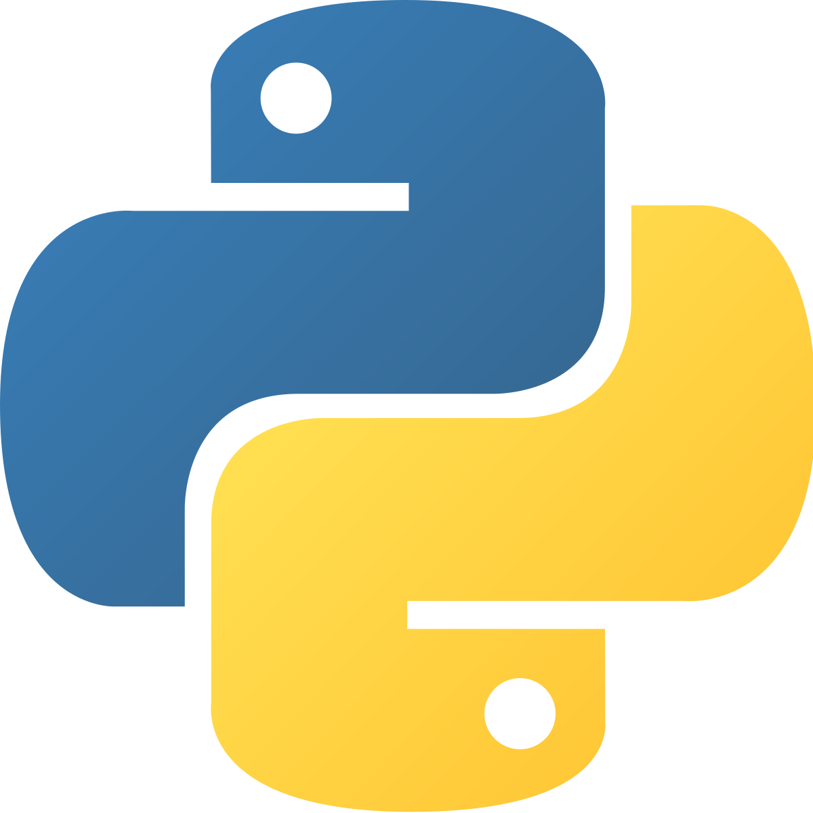 


<!-- [](https://hits.seeyoufarm.com)
 -->
This project focuses on understanding the language ecosystem, not getting into programming details.

# Summary

:sunrise_over_mountains: **_Python's Habitat_**

This topic describes how to set up the environment for Python development.
- [Preparing the Environment for the Python](#preparing-the-environment-for-the-python)
- [Check Python Configuration](#check-python-configuration)
- [Advanced settings of Python](#advanced-settings-of-python)
- [What is a virtual environment and how it works](#What-is-a-virtual-environment-and-how-it-works)

<br/>

:snake: **_Python's Taxonomy_**

This topic describes features of the pattern of Python projects.
- [Package manager](#package-manager)
- [Requirements file](#requirements-file)
- [Deterministic build](#deterministic-build)
<!-- - Principals Files -->

<br/>

:anger: **_Python's Behavior_**

This topic describes how the language is designed and how it works.
- [Compiler and interpreter](#compiler-and-interpreter)
- [How Python runs a program](#how-python-runs-a-program)
- [How Python search path module](#how-python-search-path-module)
- [How Python manages process and threads](#how-python-manages-process-and-threads)
- [How Python manages memory](#how-python-manages-memory)
- [How to deeply understand Python code execution (debug)](#how-to-deeply-understand-python-code-execution)

<!-- 
- threads
- process
- Concurrency async
- Debug
-->

<br/>

:bug: **_Python's Feeding_**

This topic describes static code analysis, formatting patterns and style guides.
- [Static code analysis](#static-code-analysis)
- [Principal style guides](#principal-style-guides)
- [Knobs (Google YAPF)](https://github.com/google/yapf#knobs)
- [My Knobs](#my-knobs)
- [Docstrings](#docstrings)

<!-- TODO - https://realpython.com/documenting-python-code/
TODO - https://docs.python-guide.org/ -->


<br/>

:mag: **_Python's Other Features_**

Extra topics.
- [Awesome Python](https://github.com/vinta/awesome-python) 
- [Why Is CPython Written in C and Not Python?](https://realpython.com/cpython-source-code-guide/#why-is-cpython-written-in-c-and-not-python)

<br/>
<br/>
<br/>

---

<br/>

## **Preparing the Environment for the Python**

<details>
    <summary><b><a href="#preparing-the-environment-for-the-python"></a> Linux</b></summary>
  
  Python needs a set of tools that are system requirements. If necessary, install these requirements with this command:
  ```bash
  sudo apt update

  sudo apt install\
    software-properties-common\
    build-essential\
    libffi-dev\
    python3-pip\
    python3-dev\
    python3-venv\
    python3-setuptools\
    python3-pkg-resources
  ```
  
  Now, the environment is done to install Python
  ```bash
  sudo apt install python
  ```
  <br/>
</details>

<details>
  <summary><b>  <a href="#preparing-the-environment-for-the-python"></a> Windows</b></summary>

  On Windows, I recommend using the package manager [chocolatey](https://chocolatey.org/) and setting your Powershell to work as admin.

  Now, install Python
  ```powershell
  choco install python 
  ```
  
  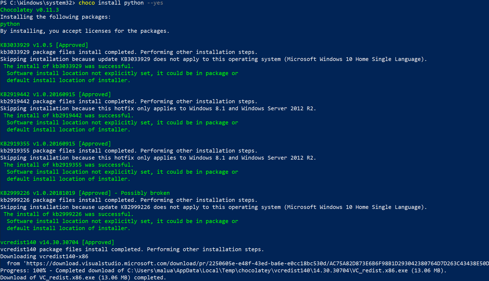
  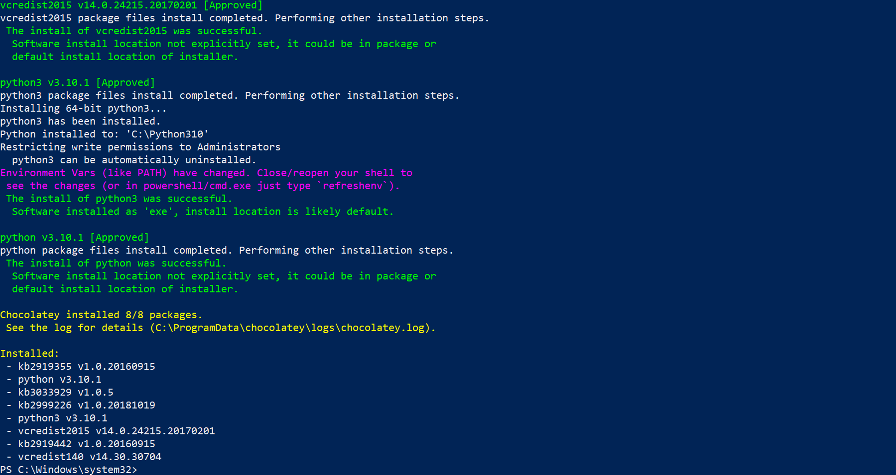
  
  <br/>
  
  Test
  ```powershell
  python --version 
  ```
  
  

  <br/>
</details>

---

<br/>

## **Check Python Configuration**
### Check **current version**

<details>	
  <summary> Watch</summary>
  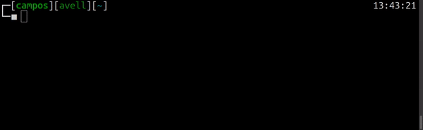
</details>

```bash
python --version
```

### Check **where** installed Python
<details>	
  <summary> Watch</summary>
  
</details>

```bash
which python
```

### Check **which Python versions** are installed
<details>	
  <summary> Watch</summary>
  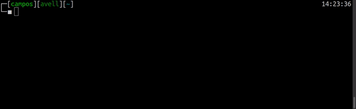
</details>
  
```bash
sudo update-alternatives --list python
```

---

<br/>

## **Advanced settings of Python**

<details>	
   <summary><b> Install multiples Python versions</b></summary>
  <!-- ### **Install multiples Python versions** -->
  Sometimes you might work on different projects simultaneously with different versions of Python. Normally using Anaconda is the easiest solution, however, there are restrictions.
  
  1. Add repository
     <details>	
       <summary> Watch</summary>
       
     </details>

     This PPA contains more recent Python versions packaged for Ubuntu.
     ```bash
     sudo add-apt-repository ppa:deadsnakes/ppa -y
     ```

  2. Update packages
     ```bash
     sudo apt update -y
     ```
     
  3. Check which Python version is installed
     ```bash
     python --version
     ```
     
  4. Install Python
     ```bash
     sudo apt install python3.<VERSION>
     ```
  <br/>
</details>

<details>	
   <summary><b> Install multiples Python versions Using Pyenv</b></summary>
  <!-- ### **Install multiples Python versions** -->
  
  1. Add dependencies
     ```bash
     sudo apt install curl -y
     ```
  
  2. Update packages
     ```bash
     sudo apt update -y
     ```

  3. Install pyenv
     ```bash
     curl https://pyenv.run | bash
     ```

  4. Add these three lines to .bashrc or .zshrc
     ```bash
     export PATH="$HOME/.pyenv/bin:$PATH"
     eval "$(pyenv init --path)"
     eval "$(pyenv virtualenv-init -)"
     ```

  5. Open a new terminal and execute
     ```bash
     exec $SHELL
     pyenv --version
     ```
     
  <br/>
</details>

<details>	
   <summary><b> Change system's Python</b></summary>
  
  Before installing other versions of Python it's necessary to set which system's Python will be used.
  
  1. Use `update-alternatives`
  
     It's possible use the `update-alternatives` command to set priority to different versions of the same software installed in Ubuntu systems. Now, define priority of versions:
     
     ```bash
     sudo update-alternatives --install /usr/bin/python python /usr/bin/python3.13 1
     
     sudo update-alternatives --install /usr/bin/python python /usr/bin/python3.12 2
      
     sudo update-alternatives --install /usr/bin/python python /usr/bin/python3.11 3
  
     sudo update-alternatives --install /usr/bin/python python /usr/bin/python3.10 4
     ```
  
     In directory `/usr/bin` will be created a symbolic link: `/usr/bin/python -> /etc/alternatives/python*`
  
  2. Choose version
  
     <details>	
       <summary> Watch</summary>
       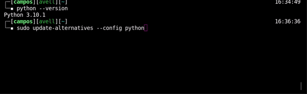
     </details>
  
     ```bash
     sudo update-alternatives --config python
     ```
  
  3. Test
     ```bash
     python --version
     ```
  <br/>
</details>


<details>
  <summary><b> Change Python2 to Python3</b></summary>
  
  If return Python **2**, try set a alias in `/home/$USER/.bashrc`, see this [example](https://github.com/brunocampos01/home-sweet-home/blob/master/config/.bashrc).
  
  ```bash
  alias python=python3
  ```
  
  **NOTE:**
  The important thing to realize is that Python 3 is not backwards compatible with Python 2. This means that if you try to run Python 2 code as Python 3, it will probably break.

  <br/>
</details>

  
  <details>
    <summary><b> Set Python's Environment Variables</b></summary>
  
  <!-- ### **Set Python's Environment Variables** -->
  - `PYTHONPATH` is an environment variable which you can set to add additional directories where python will look for modules and packages. Example: [Apache Airflow](https://airflow.apache.org/) read `dag/` folder and add automatically any file that is in this directory. 
  - To interpreter `PYTHONHOME` indicate standard packages.
  
  <br/>
  
   <details>
     <summary><b>    Set PYTHONPATH</b></summary>
    
   1. Open profile
      ```bash
      sudo vim ~/.bashrc
      ```
    
   2. Insert Python PATH
      ```bash
      export PYTHONHOME=/usr/bin/python<NUMBER_VERSION>
      ```
    
   3. Update profile/bashrc
      ```bash
      source ~/.bashrc
      ```
    
   4. Test
      ```bash
      >>> import sys
      >>> from pprint import pprint
      >>> pprint(sys.path)
      ['',
       '/usr/lib/python311.zip',
       '/usr/lib/python3.11',
       '/usr/lib/python3.11/lib-dynload',
       '/usr/local/lib/python3.11/dist-packages',
       '/usr/lib/python3/dist-packages']
      ```
      
      Example with Apache Airflow
      ```bash
      >>> import sys
      >>> from pprint import pprint
      >>> pprint(sys.path)
      ['',
       '/home/project_name/dags',
       '/home/project_name/config',
       '/home/project_name/utilities',
       ...
       ]
      ```
   </details>
   <br/>
</details>


---

<br/>

## **What is a virtual environment and how it works**
Python can run in a virtual environment with **isolation** from the system. 

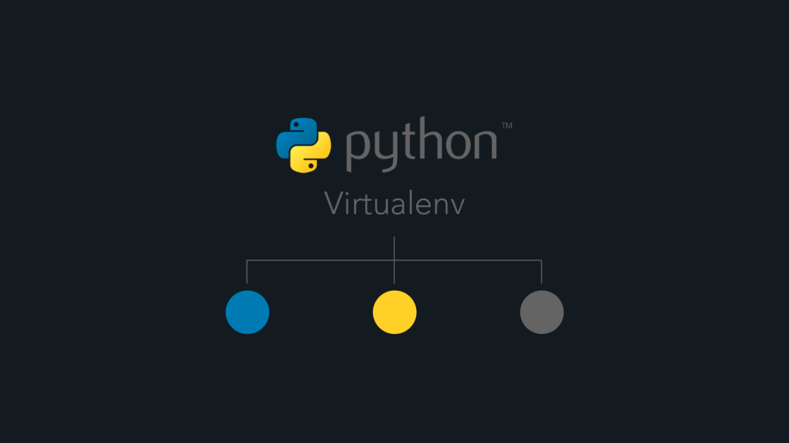

###### Image source: https://vincenttechblog.com/fix-change-python-virtualenv-settings/

<br/>

<details>
  <summary><b> Architecture of Execution</b></summary>

  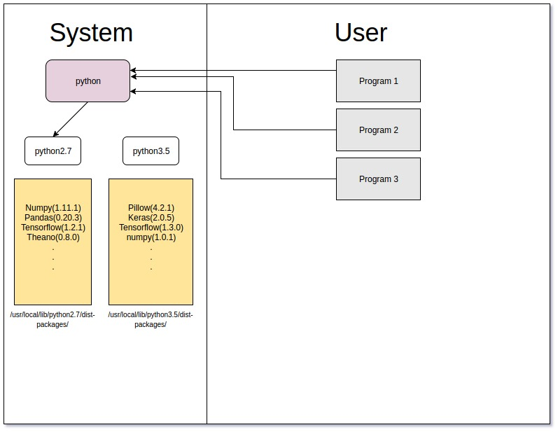
  
  <br/>
  
  Virtualenv enables us to create multiple Python environments which are isolated from the global Python environment as well as from each other.
  
  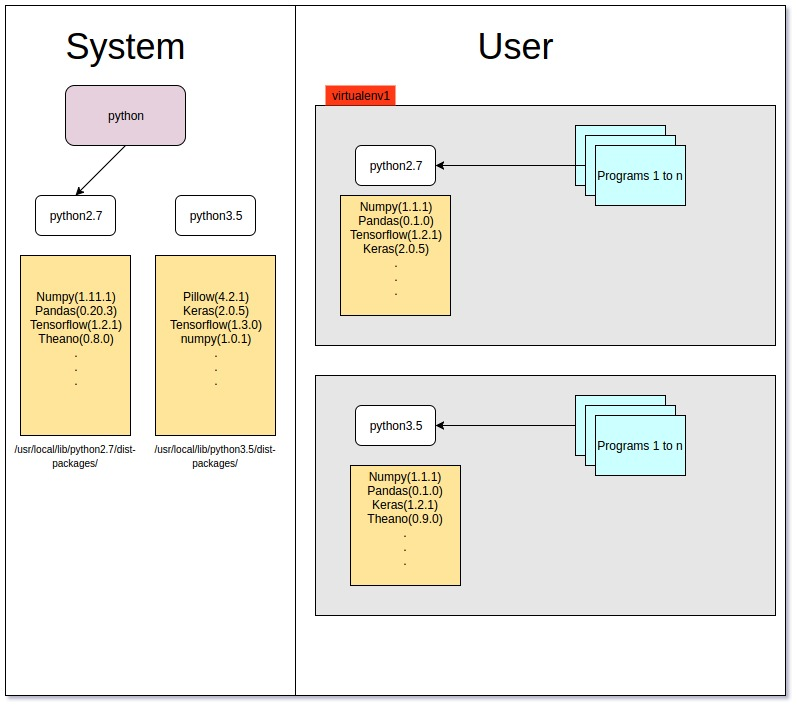
  
  <br/>
  
  When Python is initiating, it analyzes the path of its binary. In a virtual environment, it's actually just a copy or Symbolic link to your system's Python binary. Next, set the `sys.prefix` location which is used to locate the `site-packages` (third party packages/libraries)
  
  
  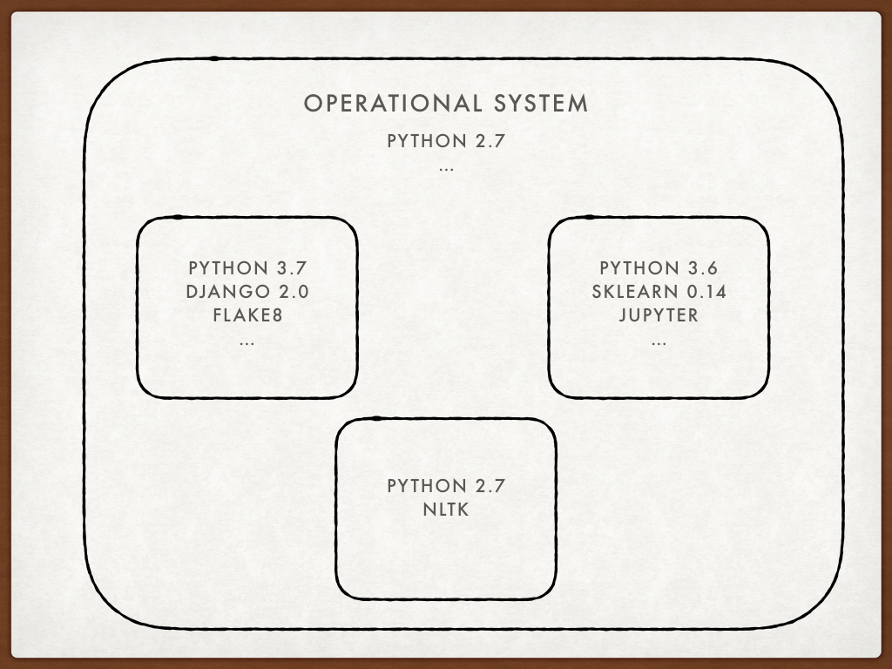
  
  <br/>
  
  #### **Symbolic link**
  - `sys.prefix` points to the virtual environment directory.
  - `sys.base.prefix` points to the **non-virtual** environment.
  
  #### **Folder of virtual environment**
  ```bash
  ll
  
  # random.py -> /usr/lib/python3.11/random.py
  # reprlib.py -> /usr/lib/python3.11/reprlib.py
  # re.py -> /usr/lib/python3.11/re.py
  # ...
  ```
  
  ```bash
  tree
  
  ├── bin
  │   ├── activate
  │   ├── activate.csh
  │   ├── activate.fish
  │   ├── pip
  │   ├── pip3
  │   ├── pip3.11
  │   ├── python -> python3.11
  │   ├── python3 -> python3.11
  │   └── python3.11 -> /usr/bin/python3.11
  ├── include
  ├── lib
  │   └── python3.11
  │       └── site-packages
  └── pyvenv.cfg
  ```
  
</details>

<details>
  <summary><b> Create Virtual Environment</b></summary>  
  <details>	
      <summary> Watch</summary>
      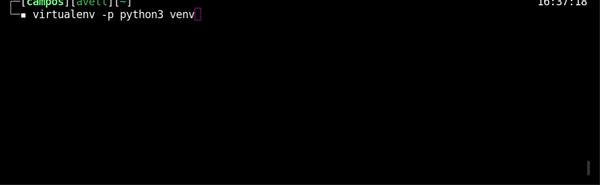
  </details>
    
  Create virtual environment (using the built-in `venv` module, recommended since Python 3.3+)
  ```bash
  python3 -m venv <NAME_ENVIRONMENT>
  ```
  
  Or using the third-party `virtualenv` package
  ```bash
  virtualenv -p python3 <NAME_ENVIRONMENT>
  ```
    
  Activate 
  ```bash
  source <NAME_ENVIRONMENT>/bin/activate
  ```
  <br/>
</details>

---

<br/>

## **Package manager**
<details>
  <summary><b> uv (recommended)</b></summary> 
  
  [uv](https://docs.astral.sh/uv/) is an extremely fast Python package and project manager written in Rust by [Astral](https://astral.sh/) (the creators of Ruff). It is **10-100x faster** than pip and serves as a single tool that can replace pip, pip-tools, pipx, poetry, pyenv, virtualenv, and more.
  
  #### **Features**
  - Extremely fast dependency resolution and installation (written in Rust)
  - Drop-in replacement for pip (`uv pip install`)
  - Built-in Python version management (`uv python install 3.12`)
  - Project management with `pyproject.toml` and cross-platform lockfile
  - Virtual environment creation and management
  - Script execution with inline dependencies
  - Tool management (replaces pipx)
  - Workspace support for monorepos
  - Deterministic builds via `uv.lock`
  
  #### **Install**
  ```bash
  # macOS / Linux
  curl -LsSf https://astral.sh/uv/install.sh | sh

  # or via pip
  pip install uv

  # or via Homebrew
  brew install uv
  ```
  
  #### **Project workflow**
  ```bash
  # Create a new project
  uv init my-project
  cd my-project

  # Add dependencies (updates pyproject.toml and uv.lock)
  uv add requests flask
  uv add --dev pytest ruff

  # Sync the virtual environment with the lockfile
  uv sync

  # Run a command inside the project environment
  uv run python main.py
  uv run pytest

  # Remove a dependency
  uv remove flask

  # Build and publish
  uv build
  uv publish
  ```

  #### **Python version management**
  ```bash
  # Install a specific Python version
  uv python install 3.12

  # List available Python versions
  uv python list

  # Pin a project to a specific version
  uv python pin 3.12
  ```

  #### **pip-compatible interface**
  ```bash
  # Works as a drop-in replacement for pip
  uv pip install requests
  uv pip install -r requirements.txt
  uv pip freeze
  uv pip compile requirements.in -o requirements.txt
  ```

  #### **pyproject.toml example**
  ```toml
  [project]
  name = "my-project"
  version = "0.1.0"
  description = "My Python project"
  requires-python = ">=3.11"
  dependencies = [
      "requests>=2.31",
      "flask>=3.0",
  ]

  [dependency-groups]
  dev = [
      "pytest>=8.0",
      "ruff>=0.4",
  ]
  ```

  [Documentation](https://docs.astral.sh/uv/) | [GitHub](https://github.com/astral-sh/uv)
  <br/>
</details>

<details>
  <summary><b> Pipenv</b></summary> 
  
  Create and manage automatically a virtualenv for your projects, as well as adds/removes packages from your Pipfile as you install/uninstall packages. It also generates the ever-important `Pipfile.lock`, which is used to produce deterministic builds.
  
  #### **Features**
  - Deterministic builds
  - Separates development and production environment packages into a single file `Pipfile`
  - Automatically adds/removes packages from your `Pipfile`
  - Automatically create and manage a virtualenv
  - Check PEP 508 requirements
  - Check installed package safety
  
  #### **Pipfile X requirements**
  ```bash
  # Pipfile
  
  [[source]]
  name = "pypi"
  url = "https://pypi.org/simple"
  verify_ssl = true
  
  [dev-packages]
  
  [packages]
  requests = "*"
  numpy = "==1.18.1"
  pandas = "==1.0.1"
  wget = "==3.2"
  
  [requires]
  python_version = "3.11"
  platform_system = 'Linux'
  ```
  
  ```bash
  # requirements.txt
  
  requests
  matplotlib==3.1.3
  numpy==1.18.1
  pandas==1.0.1
  wget==3.2
  ```
  
  <br/>
  
  ### **Install**
  ```bash
  pip3 install --user pipenv
  ```
  
  <br/>

  ### Create Pipfile and virtual environment
  1. Create environment
     <details>	
       <summary> Watch</summary>
       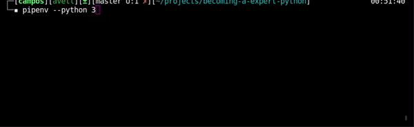
     </details>
  
     ```bash
     pipenv --python 3
     ```
  
  2. See **where** virtual environment is installed
     ```bash
     pipenv --venv
     ```
  
  3. Activate environment
     ```bash
     pipenv run
     ```
  
  4. Install packages with Pipfile
     ```bash
     pipenv install flask
     # or
     pipenv install --dev flask
     ```
  
  5. Create lock file
     <details>	
       <summary> Watch</summary>
       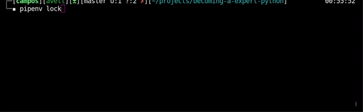
     </details>
   
     ```bash
     pipenv lock
     ```
     <br/>
</details>

<details>
  <summary><b> Python Package Index</b></summary> 
   
   [Doc Python Package Index](https://pypi.org/)
   <br/>
</details>

<details>
  <summary><b> Poetry</b></summary> 
    
   [Doc Poetry](https://python-poetry.org/)
   <br/>
</details>

<details>
  <summary><b> Conda</b></summary> 
  
  [Doc Conda](https://docs.conda.io/en/latest/)
  <br/>
</details>

---

<br/>

## **Requirements File**
`Requirements.txt` is file containing a list of items to be installed using pip install.

<details>	
  <summary><b> Principal Commands</b></summary>

  1. Visualize installed packages
  ```bash
  pip3 freeze
  ```
  
  2. Generate file `requirements.txt`
  ```bash
  pip3 freeze > requirements.txt
  ```
  
  3. Test 
  ```bash
  cat requirements.txt
  ```
  
  4. Install packages in requirements
  ```bash
  pip3 install -r requirements.txt
  ```
  <br/>
</details>

---

<br/>

## **Deterministic Build**
<!-- ### **The issue with Pip** -->
Using pip and `requirements.txt` file, have a **real issue here is that the build isn’t [deterministic](https://pt.wikipedia.org/wiki/Algoritmo_determin%C3%ADstico)**. What I mean by that is, given the same input (the `requirements.txt` file), pip does not always produce the same environment.


### **pip-tools**
A set of command line tools to help you keep your pip-based packages fresh and ensure the deterministic build.

#### **Features**
- Distinguish direct dependencies and versions
- Freeze a set of exact packages and versions that we know work
- Make it reasonably easy to update packages
- Take advantage of pip's hash checking to give a little more confidence that packages haven't been modified (DNS attack)
- Stable

<details>	
  <summary><b> Principal Commands</b></summary>

  1. Install
  ```
  pip install pip-tools
  ```
  
  2. Get packages's version
  ```bash
  pip3 freeze > requirements.in
  ```
  
  3. Generate hashes and list dependencies
  ```bash
  pip-compile --generate-hashes requirements.in
  ```
  output: [requirements.txt](requirements.txt)
  
  4. Install packages with hash checking
  ```bash
  pip-sync requirements.txt
  ```
  <br/>

</details>	

---

<br/>

## **Compiler and interpreter**
CPython can be defined as both an interpreter and a compiler.
- The **compiler** converts the `.py` source file into a `.pyc` bytecode for the Python virtual machine.
- The **interpreter** executes this bytecode on the virtual machine.

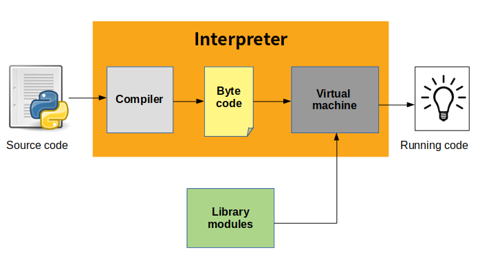

<br/>


<!-- <details>	
  <summary><b> CPython's Design</b></summary> -->

### **CPython's Design**
The principal feature of [CPython](https://en.wikipedia.org/wiki/CPython#:~:text=8%20External%20links-,Design,bytecode%20at%20any%20one%20time.), is that it makes use of a global interpreter lock (GIL). This is a mechanism used in computer-language interpreters to synchronize the execution of threads so that only one native thread can execute at a time. 
<br/>
Therefore, for a CPU-bound task in Python, single-process multi-thread Python program would not improve the performance. However, this does not mean multi-thread is useless in Python. For a I/O-bound task in Python, multi-thread could be used to improve the program performance.

<details>	
  <summary><b> Multithreading in Python</b></summary>
  The Python has multithreads despite the GIL. Using Python threading, we are able to make better use of the CPU sitting idle when waiting for the I/O bound, how memory I/O, hard drive I/O, network I/O.
  
  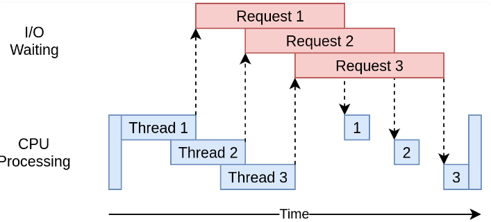
  
  <br/>
  
  This can happen when multiple threads are servicing separate clients. One thread may be waiting for a client to reply, and another may be waiting for a database query to execute, while the third thread is actually processing Python code or other example is read multiples images from disk.
  
  **NOTE:** we would have to be careful and use locks when necessary. Lock and unlock make sure that only one thread could write to memory at one time, but this will also introduce some overhead. 
  
  <!--
  ver mais sobre thread and process
  https://leimao.github.io/blog/Python-Concurrency-High-Level/ -->
  
   <br/>
</details>

<details>	
  <summary><b> Community Consensus and Free-Threaded Python (PEP 703)</b></summary>

  Historically, removing the GIL would have made **Python 3 slower in comparison to Python 2** in single-threaded performance. Another problem was that removing the GIL would **break existing C extensions** which depend heavily on it.
  <br/>
  However, [PEP 703](https://peps.python.org/pep-0703/) was **accepted in October 2023**, and **Python 3.13** (released October 2024) includes **experimental free-threaded mode** where the GIL can be disabled:
  
  ```bash
  # Run Python 3.13 without the GIL
  python3.13t script.py
  
  # Or disable at runtime
  PYTHON_GIL=0 python3.13 script.py
  python3.13 -X gil=0 script.py
  ```
  
  ```python
  # Check GIL status at runtime
  import sys
  print(sys._is_gil_enabled())  # Python 3.13+
  ```
  
  **Key points about free-threaded Python:**
  - The free-threaded build uses `python3.13t` (the "t" suffix means "threaded")
  - It is still **experimental** -- not all C extensions support it yet
  - Performance varies by workload: some CPU-bound tasks see significant speedups, while single-threaded code may be slightly slower
  - C extension authors must explicitly opt in via `Py_mod_gil` slot
  
  <br/>
</details>


---

<br/>

## **How Python runs a program**
1. Tokenize the source code: `Parser/tokenizer.c`
2. Parse the stream of tokens into an Abstract Syntax Tree (AST): `Parser/parser.c`
3. Transform AST into a Control Flow Graph: `Python/compile.c`
4. Emit bytecode based on the Control Flow Graph: `Python/compile.c`


---

<br/>

## **How Python search path module**
When Python executes this statement:
```python
import my_lib
```
The interpreter searches `my_lib.py` a list of directories
assembled from the following sources: <!-- montada a partir das seguintes fontes: -->
- Current directory
- The list of directories contained in the **PYTHONPATH** environment variable
- In directory which Python was is installed. E.g. 
  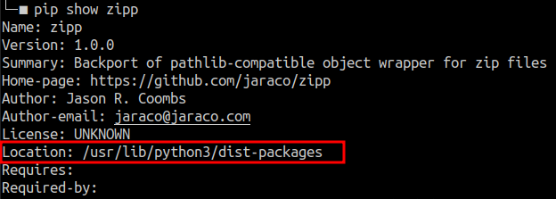


The resulting search can be accessed using the **sys** module:
```python
import sys

sys.path
# ['', '/usr/lib/python311.zip', 
# '/usr/lib/python3.11',
# '/usr/lib/python3.11/lib-dynload',
# '/home/campos/.local/lib/python3.11/site-packages',
# '/usr/local/lib/python3.11/dist-packages',
# '/usr/lib/python3/dist-packages']
```

<br/>

Now, to see where a package was imported from you can use the attribute `__file__`:
```python
import zipp

zipp.__file__
# '/usr/lib/python3/dist-packages/zipp.py'
```

> NOTE: you can see that the `__file__` directory is in the list of directories searched by the interpreter.

<!-- TODO
- how check what was imported ?
  - `dir()` function
- package initiazion
  - __init__
  - __all__
https://realpython.com/python-modules-packages/#package-initialization -->

---

<br/>

## **How Python manages process and threads**

CPython uses the **Global Interpreter Lock (GIL)**, which allows only one thread to execute Python bytecode at a time. This has important implications:

- **CPU-bound tasks**: Multi-threading does NOT improve performance due to the GIL. Use `multiprocessing` or `concurrent.futures.ProcessPoolExecutor` instead.
- **I/O-bound tasks**: Multi-threading IS effective because threads release the GIL while waiting for I/O (network, disk, etc.). Use `threading` or `concurrent.futures.ThreadPoolExecutor`.
- **Async I/O**: For high-concurrency I/O-bound workloads, `asyncio` provides cooperative multitasking with a single thread.

```python
# CPU-bound: use multiprocessing
from concurrent.futures import ProcessPoolExecutor
with ProcessPoolExecutor() as executor:
    results = executor.map(cpu_heavy_func, data)

# I/O-bound: use threading
from concurrent.futures import ThreadPoolExecutor
with ThreadPoolExecutor() as executor:
    results = executor.map(io_bound_func, urls)

# Async I/O
import asyncio
async def fetch_all(urls):
    async with aiohttp.ClientSession() as session:
        tasks = [session.get(url) for url in urls]
        return await asyncio.gather(*tasks)
```

**References:**
- [What Is the Python GIL?](https://realpython.com/python-gil/)
- [Speed Up Python with Concurrency](https://realpython.com/courses/speed-python-concurrency/)
- [Intro to Python Threading](https://realpython.com/intro-to-python-threading/)

---

<br/>

## **How Python manages memory**

Python uses **automatic memory management** with two key mechanisms:

1. **Reference Counting**: Every object has a reference count. When it drops to zero, the memory is immediately freed.
2. **Garbage Collector**: Handles circular references that reference counting cannot detect. Uses a generational approach (3 generations) to optimize collection.

```python
import sys

a = [1, 2, 3]
print(sys.getrefcount(a))  # reference count (includes the getrefcount arg itself)

import gc
gc.collect()  # manually trigger garbage collection
print(gc.get_stats())  # stats per generation
```

Key points:
- **Small integers** (-5 to 256) and **interned strings** are cached and reused.
- **Memory pools**: CPython uses a private heap with an internal memory allocator (`pymalloc`) for small objects (< 512 bytes).
- Use `tracemalloc` to trace memory allocations and find leaks.

**References:**
- [How Python Manages Memory](https://realpython.com/courses/how-python-manages-memory/)
- [tracemalloc](https://docs.python.org/3/library/tracemalloc.html)


---

<br/>

## **How to deeply understand Python code execution**

Several tools help you trace, debug, and profile Python code:

**Debuggers:**
- **pdb** (built-in): Insert `breakpoint()` in your code and step through with `n` (next), `s` (step into), `c` (continue).
- **PyCharm Debugger**: Set breakpoints visually, inspect variables, evaluate expressions.
- **VS Code Debugger**: Similar to PyCharm with the Python extension.

**Profilers:**
- **cProfile**: Built-in CPU profiler. Run with `python -m cProfile -s cumtime script.py`.
- **tracemalloc**: Built-in memory profiler. Traces memory allocations to find leaks.
- **line_profiler**: Line-by-line CPU profiling with `@profile` decorator.

**Other Tools:**
- **coverage.py**: Measure code coverage of your tests with `coverage run -m pytest && coverage report`.
- **PySnooper**: Decorator-based tracing that logs every line execution, variable changes, and return values.

```python
# Using pdb
def buggy_function(x):
    breakpoint()  # drops into pdb here
    return x * 2

# Using tracemalloc
import tracemalloc
tracemalloc.start()
# ... your code ...
snapshot = tracemalloc.take_snapshot()
for stat in snapshot.statistics('lineno')[:10]:
    print(stat)
```

**References:**
- [tracemalloc](https://docs.python.org/3/library/tracemalloc.html)
- [coverage.py](https://pypi.org/project/coverage/)
- [PySnooper](https://github.com/cool-RR/PySnooper)


---

<br/>

## **Static code analysis**
The static code analysis serves to **evaluate the coding**. This analysis must be done before submitting for a code review. The static code analysis can check:
- Code styling analysis
- Comment styling analysis
- Error detection
- Duplicate code detection
- Unused code detection
- Complexity analysis
- Security linting

The characteristics of a static analysis are:
- Provides insight into code without executing it
- Can automate code quality maintenance
- Can automate the search for bugs at the early stages
- Can automate the finding of security problems

A lint, is a [static code analysis tool](https://en.wikipedia.org/wiki/Lint_(software)).

<details>	
  <summary><b> Pylint</b></summary>

  [Pylint](https://pylint.org/) is a lint that checks for errors in Python code, tries to enforce a coding standard and looks for code smells. The principal features is:
  - Pylint follows the [PEP 8](https://peps.python.org/pep-0008/) style guide.
  - It's possible automate with Jenkins.
  - It is fully customizable through a `.pylintrc` file where you can choose which errors or agreements are relevant to you.
  - Usage
    ```bash
    # Get Errors & Warnings
    pylint -rn <file/dir> --rcfile=<.pylintrc>

    # Get Full Report
    pylint <file/dir> --rcfile=<.pylintrc>
    ```  
  <details>	
  <summary><b> Example execution</b></summary>
    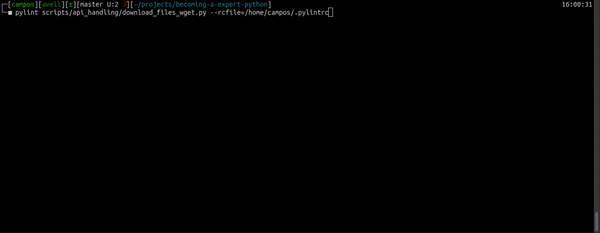
  <br/>
  </details>
  
  <br/>
</details>

<details>	
  <summary><b> Ruff</b></summary>

  [Ruff](https://docs.astral.sh/ruff/) is an extremely fast Python linter and formatter written in Rust. It can replace Pylint, Pyflakes, isort, and many other tools in a single pass.
  ```bash
  # Lint the whole project
  ruff check ./src/

  # Lint and auto-fix
  ruff check --fix ./src/

  # Format (replaces black)
  ruff format ./src/
  ```
  <br/>
</details>

<details>	
  <summary><b> Pyflakes</b></summary>

  [Documentation Pyflakes](https://github.com/PyCQA/pyflakes)
  <br/>
</details>

<details>	
  <summary><b> Mypy</b></summary>

  [Documentation Mypy](https://mypy-lang.org/)
  <br/>
</details>

<details>	
  <summary><b> Prospector</b></summary>

  [Documentation Prospector](https://github.com/prospector-dev/prospector) 
  <br/>
</details>

---

<br/>

## Other Tools to make an effective Python style guide
<details>	
  <summary><b> Isort</b></summary>

  [isort](https://pypi.org/project/isort/) is a Python tool/library for sorting imports alphabetically, automatically divided into sections. It is very useful in projects where we deal with a lot of imports [6].
  ```bash
  # sort the whole project (isort 5+ traverses directories automatically)
  isort ./src/
  
  # just check for errors
  isort script.py --check-only
  ``` 
  <br/>
</details>

<details>	
  <summary><b> Unify</b></summary>

  Someone likes to write them in single quotes, someone in double ones. To unify the whole project, there is a tool that allows you to automatically align with your style guide — [unify](https://pypi.python.org/pypi/unify) [6].
  ```bash
  unify --in-place -r ./src/
  ```
  Work recursively for files in the folder.
  
  <br/>
</details>

<details>	
  <summary><b> docformatter</b></summary>

  [docformatter](https://pypi.org/project/docformatter/) is a utility that helps bring your docstrings under [PEP 257](https://peps.python.org/pep-0257/) [6]. The standard specifies how documentation should be written.
  ```bash
  docformatter --in-place example.py
  ```
  
  <br/>
</details>

<details>	
  <summary><b> Autoformatters</b></summary>

  There are also automatic code formatters now, here are the popular ones [6]:
  - [black](https://github.com/psf/black) (you don't need a style guide because you don't have a choice)
  - [ruff format](https://docs.astral.sh/ruff/formatter/) (extremely fast, drop-in replacement for black)
  - [autopep8](https://github.com/hhatto/autopep8) (makes your python script conform to PEP 8 style guide)
  - [yapf](https://github.com/google/yapf) (customizable style guide; **note:** relies on `lib2to3` which has limited support for Python 3.10+ syntax)
  
  <br/>
</details>

<details>	
  <summary><b> Settings files to text editor and IDE</b></summary>

  - EditorConfig
  - Gitattributes
 
 <br/>
</details>

---

<br/>

## **Principal style guides**
To make the code consistent and make sure it's readable the _style guides_ can help.
- [Google style guide: THE BETTER](https://google.github.io/styleguide/pyguide.html) 
- [Real Python: Naming Conventions](https://realpython.com/python-pep8/#naming-conventions)
- [PEP 08: Style Guide](https://peps.python.org/pep-0008/)
- [PEP 257: Docstrings](https://peps.python.org/pep-0257/)
- [PEP 484: Type Hints](https://peps.python.org/pep-0484/)

---

<br/>

## **My Knobs**

<details>
  <summary><b> Indentation and Length</b></summary> 
  
  - 4 spaces
  - Limit all lines to a maximum **72 characters to docstring or comments**
  - Limit all lines to a maximum **79 characters to code**  
  <br/>
</details>

<details>
  <summary><b> Naming Convention</b></summary> 

  - Class Name (PascalCase): `CapWords()`
  - Variables (snake_case): `cat_words`
  - Constants: `MAX_OVERFLOW`
  <br/>
</details>


<details>
  <summary><b> Exception</b></summary> 
  
  Limit the clausule `try:` minimal code necessary.
  
  Yes:
  ```Python
  try:
      value = collection[key]
  except KeyError:
      return key_not_found(key)
  else:
      return handle_value(value)
  ```
  
  No:
  ```Python
  try:
      # Too broad!
      return handle_value(collection[key])
  except KeyError:
      # Will also catch KeyError raised by handle_value()
      return key_not_found(key)
  ```
  
  - The goal to answer the question **"What went wrong?"** programmatically rather than just claiming that _"There was a problem"_
  <br/>
</details>

<details>
  <summary><b> Return</b></summary> 
  
  "_Should explicitly state this as return None_"
  
  - Be consistent in return statements.
  - All return statements in a function should return an expression, or none of them should.
  
  Yes:
  ```Python
  def foo(x):
      if x >= 0:
          return math.sqrt(x)
      else:
          return None
  ```
  
  No:
  ```Python
  def foo(x):
      if x >= 0:
          return math.sqrt(x)
  ```
  <br/>
</details>

---

<br/>

## **Docstrings**

Docstrings must have:
- Args
- Returns
- Raises


<details>
  <summary><b> Example Google Style Guide</b></summary> 

  ```Python
  def fetch_bigtable_rows(big_table, keys, other_silly_variable=None):
      """Fetches rows from a Bigtable.
  
      Retrieves rows pertaining to the given keys from the Table instance
      represented by big_table.  Silly things may happen if
      other_silly_variable is not None.
  
      Args:
          big_table: An open Bigtable Table instance.
          keys: A sequence of strings representing the key of each table row
              to fetch.
          other_silly_variable: Another optional variable, that has a much
              longer name than the other args, and which does nothing.
  
      Returns:
          A dict mapping keys to the corresponding table row data
          fetched. Each row is represented as a tuple of strings. For
          example:
  
          {'Serak': ('Rigel VII', 'Preparer'),
           'Zim': ('Irk', 'Invader'),
           'Lrrr': ('Omicron Persei 8', 'Emperor')}
  
          If a key from the keys argument is missing from the dictionary,
          then that row was not found in the table.
  
      Raises:
          IOError: An error occurred accessing the bigtable.Table object.
      """
      return None
  ``` 
  <br/>
</details>


<!-- TODO
- Side effects: https://realpython.com/defining-your-own-python-function/#side-effects
- return: https://realpython.com/defining-your-own-python-function/#exiting-a-function -->

---

<br/>

<details>	
  <summary><b> References</b></summary>
  
  - 1: [Python 3 Installation & Setup Guide](https://realpython.com/installing-python/)
  - 2: [An Effective Python Environment: Making Yourself at Home](https://realpython.com/effective-python-environment/)
  - 3: [Import Scripts as Modules](https://realpython.com/python-import/#import-scripts-as-modules)
  - 4: [Python Modules and Packages – An Introduction](https://realpython.com/python-modules-packages/)
  - 5: [What Is the Python Global Interpreter Lock (GIL)?](https://realpython.com/python-gil/)
  - 6: [7 tips to make an effective python style guide](https://luminousmen.com/post/7-tips-to-make-an-effective-python-style-guide)
  - 7: [Python Static Analysis Tools](https://luminousmen.com/post/python-static-analysis-tools)
  - 8: [My unpopular opinion about black code formatter](https://luminousmen.com/post/my-unpopular-opinion-about-black-code-formatter)
  <br/>
</details>

---

<p  align="left">
	<br/>
	<a href="mailto:brunocampos01@gmail.com" target="_blank">
	</a>
	<a href="https://stackoverflow.com/users/8329698/bruno-campos" target="_blank">
	</a>
	<a href="https://www.linkedin.com/in/brunocampos01" target="_blank">
	</a>
	<a href="https://github.com/brunocampos01" target="_blank"></a>
	<a href="https://medium.com/@brunocampos01" target="_blank">
	</a>
    <a rel="license" href="http://creativecommons.org/licenses/by-sa/4.0/">
    </a>
    <br/>
</p>
